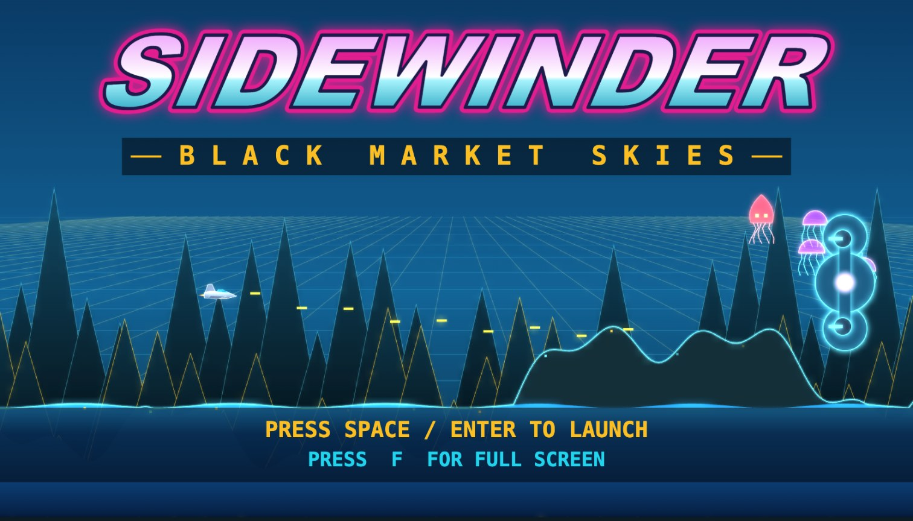
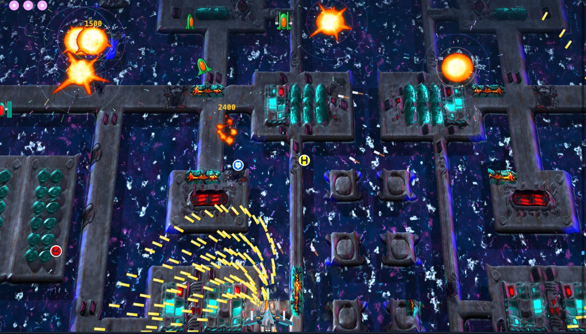
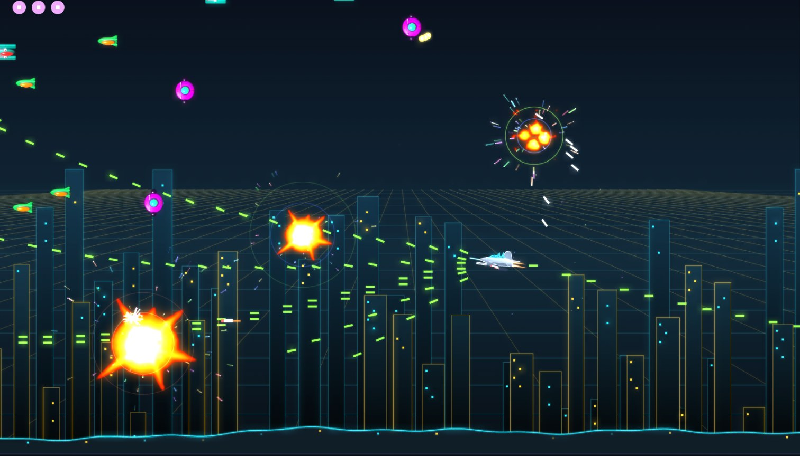
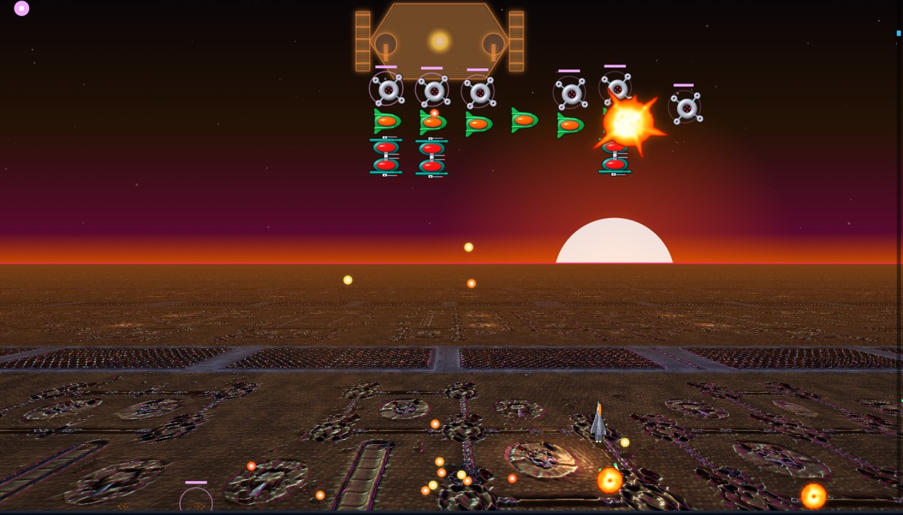
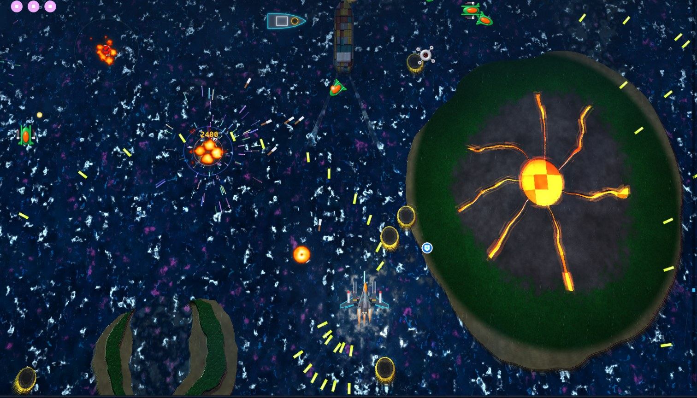

<div align="center">

# SideWinder: Black Market Skies

**A fast, loud, neon arcade shooter that runs in your browser. No install, no build step, no dependencies.**

[](https://thedigitalpolymath.com/sidewinder/)

[](https://thedigitalpolymath.com/sidewinder/)
[](https://github.com/rjvaleo/sidewinder/commits/main)
[](https://github.com/rjvaleo/sidewinder/commits/main)
[](https://github.com/rjvaleo/sidewinder)
[](https://github.com/rjvaleo/sidewinder)
[](https://github.com/rjvaleo/sidewinder/stargazers)
[](https://github.com/rjvaleo/sidewinder/issues)


[](https://thedigitalpolymath.com/sidewinder/)

</div>

## Play

**https://thedigitalpolymath.com/sidewinder/**

It runs in any current desktop browser. Plug in a gamepad if you have one, press **F** for full screen, and turn the sound up.

## What it is

SideWinder started as a browser version of the 1988 Amiga vertical shooter of the same name and has grown well past it. The first six levels follow the original. Everything after that is new: new worlds, new views, bosses, an arms dealer, and a ship that gets bigger and meaner as you spend your credits.

## Features

- **18 levels.** The six original levels, then a second loop of twelve more.
- **Three ways to see the fight.** Top-down levels over a lit 3D ground, side-scrolling levels in between, and a horizon view at the end of each top-down level where a wall of ships forms up in the sky.
- **A boss on every level.** They get tougher and busier as they are worn down, and they wait behind the formation until you shoot it away.
- **Six generated worlds** with their own terrain, including a water world with its own sea creatures.
- **Arms dealer.** Twelve upgrades to buy between levels: cannons, spread, lasers, missiles, shields, drones, salvage and more.
- **Nova bombs** that clear the screen.
- **Elite enemies** that take real work to bring down, and enemies that get tougher as the levels go on.
- **A bonus cave** on each top-down level, with power-ups that exist nowhere else.
- **Twin-stick aiming** on a gamepad, or keyboard and mouse.
- **Five difficulty settings** and a trainer mode.
- **Full sound**: a 48-voice mixer, engine and ambience loops for every world, and interface sounds.

## Screenshots

| Top-down | Side-scroller |
| --- | --- |
|  |  |

| Horizon stage | Generated world |
| --- | --- |
|  |  |

## Controls

### Keyboard and mouse

| Action | Keys |
| --- | --- |
| Move | Arrow keys or WASD |
| Fire | Space, Z, Enter or mouse click |
| Bomb | B |
| Nova bomb | N |
| Pause | P |
| Full screen | F |

### Gamepad

| Action | Control |
| --- | --- |
| Move | Left stick or D-pad |
| Aim and fire | Right stick |
| Fire ahead | A, B or X |
| Bomb | Triggers |
| Nova bomb | L1 or Y |
| Pause | Start |

## Run it yourself

There is nothing to install or build.

```bash
git clone https://github.com/rjvaleo/sidewinder.git
cd sidewinder
python3 -m http.server 8000
```

Then open http://localhost:8000/ in your browser. Any static file server works.

## How it is built

| Part | What it does |
| --- | --- |
| `index.html` | The page: canvas, stage and difficulty pickers, buttons |
| `port/game.js` | The whole game, in plain JavaScript |
| `port/assets_*.js` | Sprites, maps, ground lighting data and sound, bundled as scripts |
| `port/levels2/` | The six generated worlds, loaded one at a time when needed |
| `port/ambient/` | Drop-in folder for your own ambience tracks |

- **Rendering:** 2D canvas for sprites and effects, with a WebGL fragment shader lighting the ground per pixel (relief, parallax, shadows, water, lava).
- **Timing:** a fixed 50 Hz game step, the same as the Amiga original.
- **Sound:** Web Audio, with a limiter and a 48-voice cap.
- **Input:** keyboard, mouse and the browser Gamepad API.

## Browser support

Current versions of Chrome, Edge, Firefox and Safari on desktop. WebGL is used for the ground when it is available, with a plain canvas fallback when it is not.

## Privacy

The hosted game uses Google Analytics to count plays and see how far players get (levels started and finished, bosses beaten, upgrades bought). It collects nothing you type and has no accounts.

## Feedback

Found a bug or have an idea? [Open an issue](https://github.com/rjvaleo/sidewinder/issues).

## Disclaimer

This is an unofficial fan project. It is not affiliated with or endorsed by the original developer or publisher, and SideWinder remains the property of its rights holders.
